# 搜索（查找）

## AVL Trees（实时调控）

### 1. 背景

背景：为了快速查找，BST会出现插入时，树的好坏依赖于插入顺序的情况，以此引入AVL树。

### 2. 平衡条件

对于好坏的描述：采用Average search time
> [!NOTE]
> height balanced，balance factor BF 定义
>
> height balanced：左右字数也 height balanced，并且左右子树高度差不超过 1。
>
> $BF(node) = h_L-h_R / h_R-h_L$

### 3. 调整操作

判断怎么转的时候只看三层（是从出现问题的那个节点开始往下算的）

#### RR rotation（LL rotation同理）

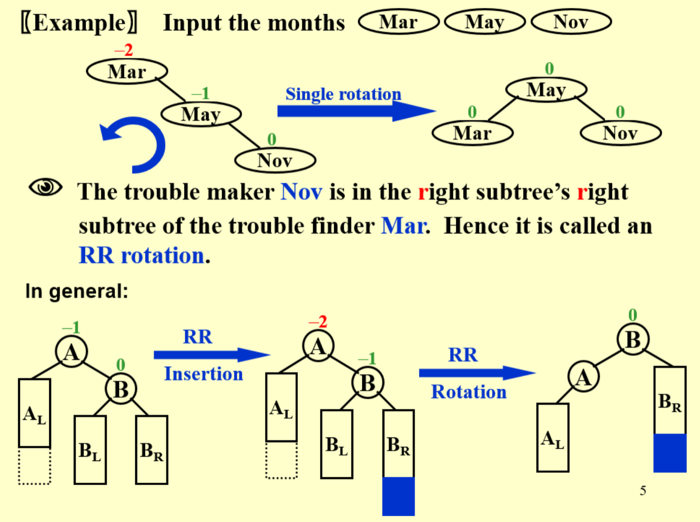

基础方法：向右下两个出现2，将中间的转到上面
总体方法：如果这个新根(B)，有左子树的话，挂到原来的根(A)的右侧。

#### LR rotation

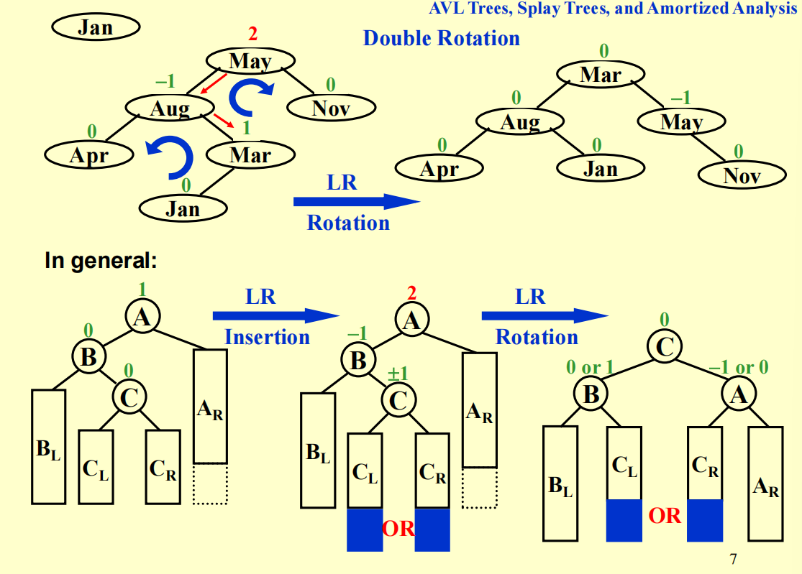

基础/总体方法：将最下面的那个结点(Mar)变成看的最上面的那个，原来的向右边走。原来的下面的结点(Mar)直接挂在第二层的下面。小的在左边，大的在右边。（要换挂的节点就换下面挂着的那个）

#### RL rotation

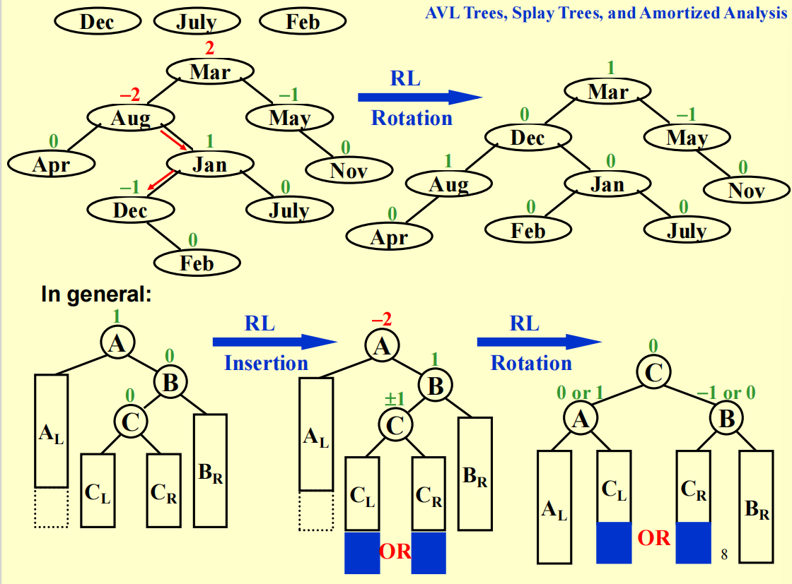

基础方法：将最下面的那个节点(Dec)变成看的最上面的那个，原来的往左走。原来下面的结点直接挂在第二层下面。

### 注意事项

> [!NOTE]
> 在加节点但是没有进行调换的时候也要进行 BF 的更新。

- 也可以用height field来计算，不过每一次都要进行计算
- 挂到第二层的方法是正确的，证明只需要再说明一下大小关系

### 4. 复杂度证明

证明:AVL树每次查找的时候时间复杂度为O(ln n)

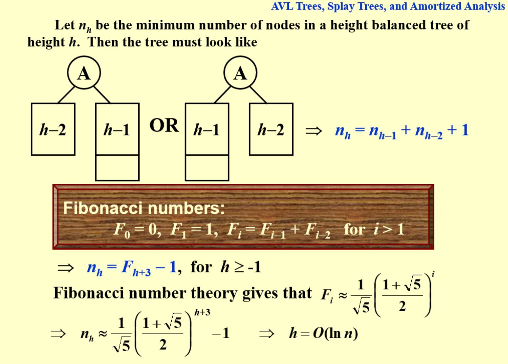

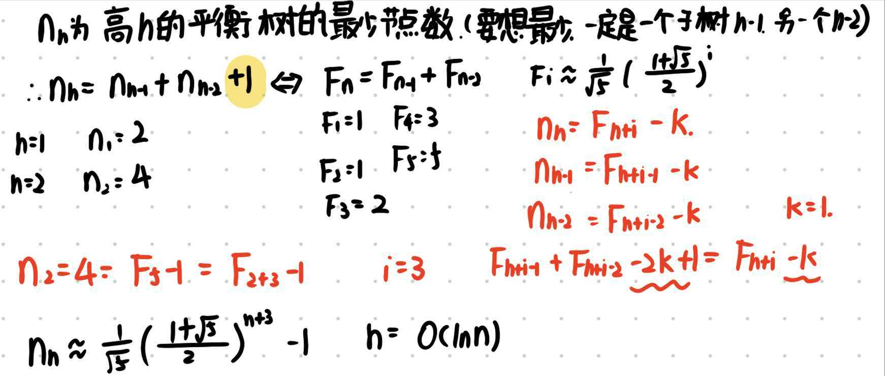

## Splay Trees

### 1. 背景

背景：为了使任意M个操作总体时间为O(Mlog N)，Amortized time是O(log N)

### 2. 基本方法

做法：要让上一次最坏下一次就最好，上次是O(N)找到的就用AVL旋到根上（旋也有方法注意）

### 3. 调整操作

调整操作：
让选中的节点变为根节点

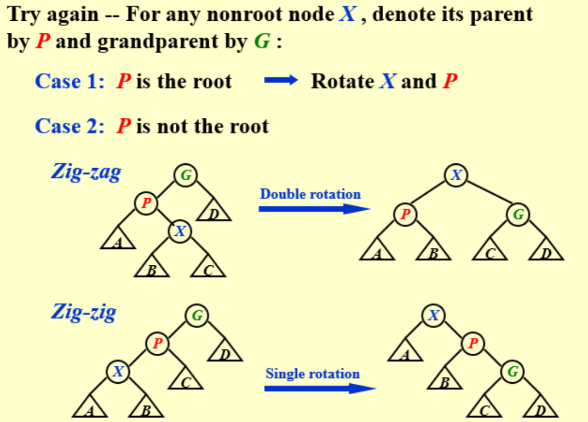
Zig-zag(原来的三个节点方向不一样，之字形，方向相反，转的方向相反)和zig-zig(原来的三个节点方向一样，都向左或向右，一字形，方向相同，转的方向相同)

### 4. 删除操作

删除操作：

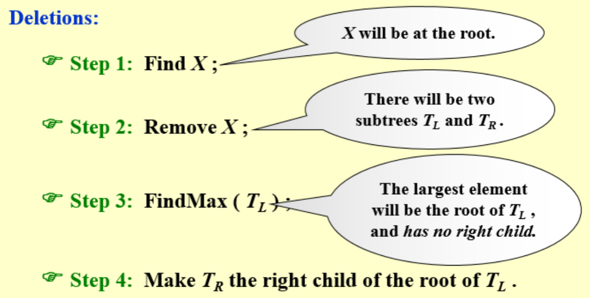

## Amortized Analysis

摊还时间：连续n次总的真实时间的结果
$worst-case bound \geq amortized bound \geq average-case bound$

方法：
### Aggregate analysis

直接找最坏的情况进行平均

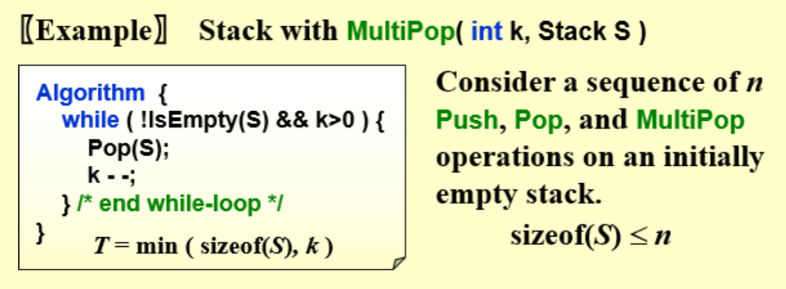

最坏是2n-1，平均是O(1)
### Accounting method

需要去猜平均值进行摊还（类似于在银行存钱）

（银行不能是负的）（这样做，我们可以保证我们得到的这个$\hat{c}_i$比，需要找到比较合适的函数，合适的话就能出结果）

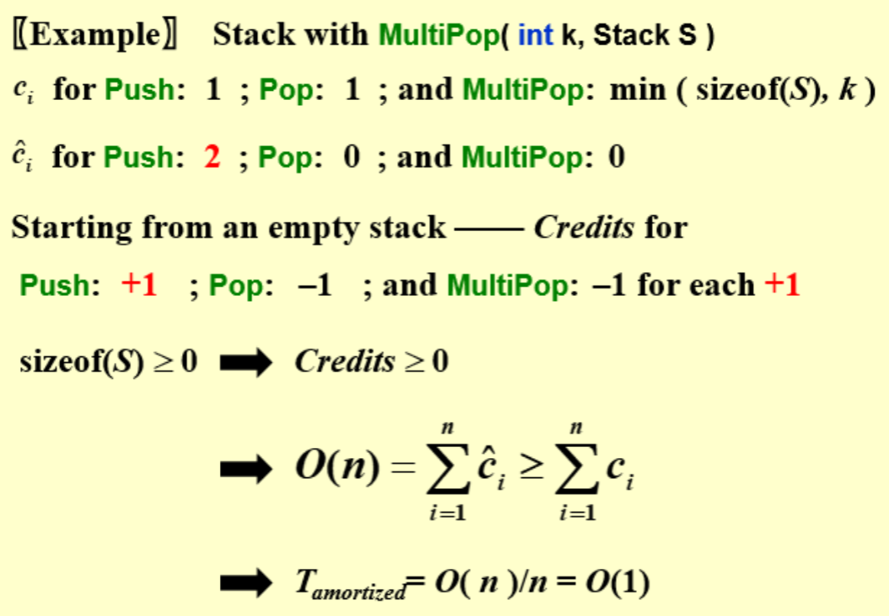

### Potential method

对credit进行讨论，给出Potential function

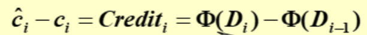

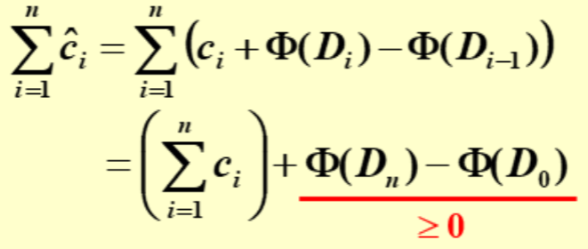

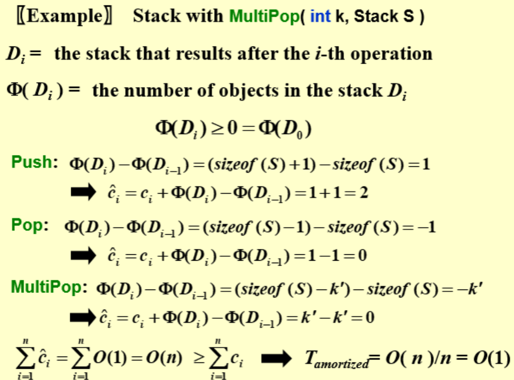

### 用Potential method来证明Amortized time成立

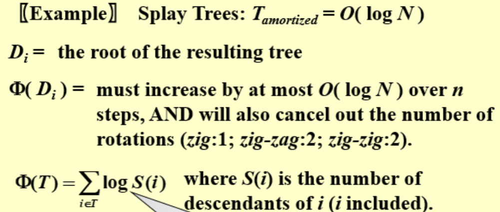

$\Phi(D_i)$在n步操作中，最多增加O(logN)，并且还要抵消掉旋转的次数
$\Phi(T)$可以表示树高（此时的树高和比较平衡的树的高度相差常数）
不能直接用树高：

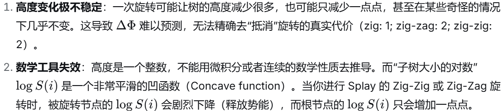

推导：

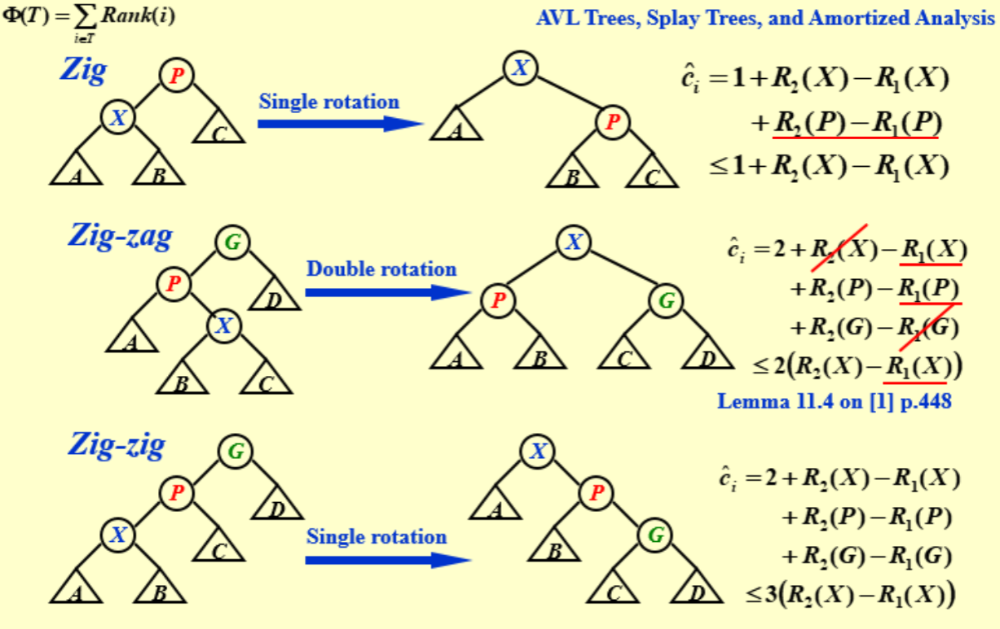

Zig:因为$R_2(X)-R_1(X) \leq 0$，所以可以直接变成$\leq$消掉
Zig-zag:$R_2(X)-R_1(G)$正好为0，观察得到$R_1(P) \geq R_1(X)$,把$R_1(P)$放缩成$R_1(X)$。符号是$\leq$，成立。操作后P和G是X的两个子树，

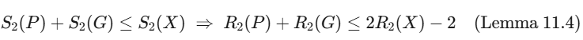。最后得到结果
S和R之间变换的式子的证明：

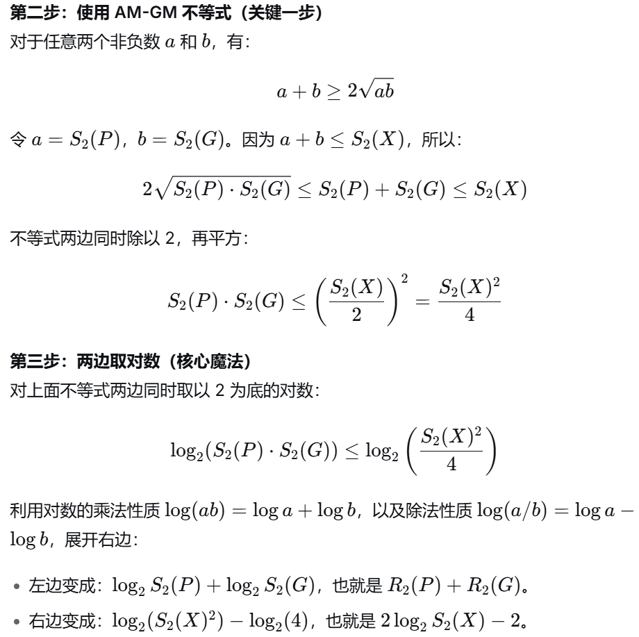

Zig-zig:前两步与上面的相同，

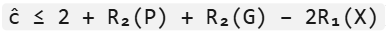

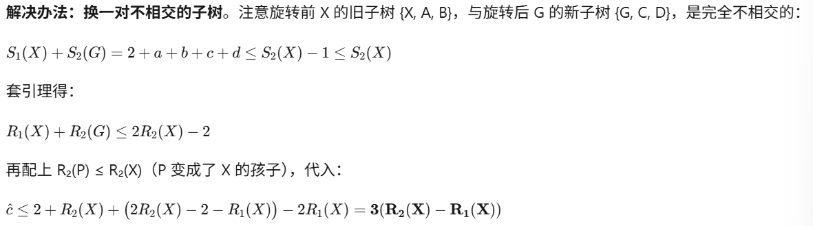

最终结论为：$\hat{c}_i \leq 1+3(R_2(X)-R_1(X))$

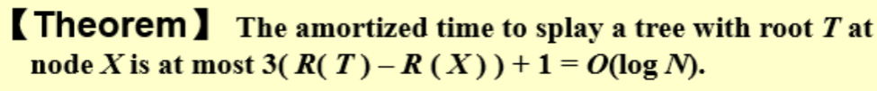

### 注意事项：

练习题见平板笔记
